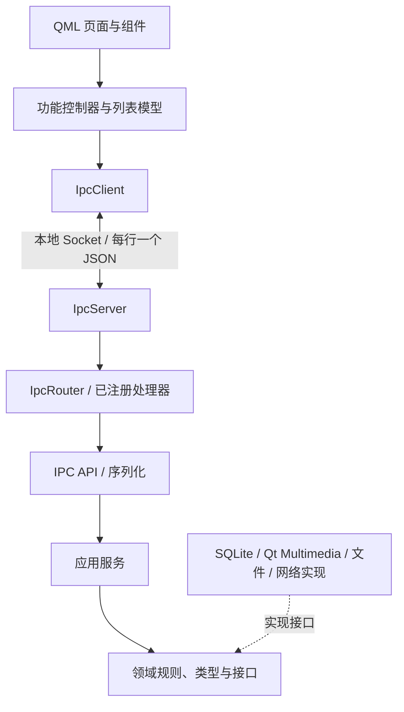

# NekoTune 架构与扩展开发

本文说明当前源码的职责、依赖和扩展约定。构建与使用见 [README](../README.md)，协议字段和方法见 [API 文档](API.md)，其他专题见[文档导航](README.md)。

NekoTune 使用分层模块化架构：QML 展示界面，前端 C++ 控制器拥有功能状态，应用服务组织业务，领域类型与接口隔离存储、播放和网络实现。后端服务由构造函数显式注入，装配集中在 `BackendSession`；内置功能采用编译期模块注册，用户扩展以 Qt 插件形式在后端进程内加载，并通过动态 QML 注册接入。

## 1. 运行方式与启动入口

| 可执行文件 | 入口 | 运行方式 |
| --- | --- | --- |
| `nekotune` | `frontend/qt-qml/src/main.cpp` | GUI 主线程运行前端，`BackendRuntime` 在专用线程启动后端 |
| `nekotune-backend` | `backend/main.cpp` | 无界面进程，通过 `BackendRuntime` 启动同一套后端 |
| `nekotune-qt-qml` | `frontend/qt-qml/src/main.cpp` | 只启动前端，通过本地 Socket 连接已有后端 |

统一程序通过 `NEKOTUNE_EMBED_BACKEND` 编译定义启用后端启动逻辑，仍使用与独立客户端相同的 IPC 链路。独立前端目标不链接后端业务库。

可选音乐壁纸由前端 `wallpaper/WallpaperManager` 管理，同一 QML 引擎为每个选定输出创建窗口，共享控制器与 IPC；Wayland / Win32 只存在于前端平台实现。没有额外播放器或后端接口，退出先销毁壁纸再释放引擎。主窗口／迷你窗口的 presentation 可见性不包含壁纸；平台支持、用户启用意愿与每屏映射状态分别记录。详见[壁纸设计及限制](wallpaper.md)。

经典卡片、黑胶唱片及全屏歌词通过壁纸窗口内的 Loader 切换，共用 `WallpaperTrackInfo`、`AlbumArt` 和 `CompactLyrics`。样式设置只影响前端布局，不重新创建原生窗口或发送播放／歌词请求；替换布局时释放旧动画和歌词时钟。

统一模式的启动顺序：

1. `BackendRuntime` 启动线程，在该线程内创建 `BackendSession`。
2. `BackendSession` 创建数据库会话、仓储、基础设施、应用服务和 IPC 对象，注册方法并连接事件。
3. `BackendSession::start()` 检查数据库、监听 Socket 并启动曲库扫描。
4. 前端创建 `IpcClient`、`AppControllers`、翻译器和 QML 引擎，加载 `Main.qml`。
5. 连接建立后，后端发送 `server.connected` 状态快照；各前端控制器初始化自己的状态，曲库控制器请求扫描和列表刷新。

同一 Socket 名称只允许一个后端。分离运行时前后端应共享 `NEKOTUNE_HOME` 和 `NEKOTUNE_SOCKET`，以保持配置和连接一致。

## 2. 调用链与依赖边界

下面实线表示请求调用方向，虚线表示接口实现关系：



事件沿 IPC 返回前端，由订阅该事件的控制器更新属性或模型。业务服务返回类型化数据和 `Result<T>`，JSON 转换集中在 IPC 层。

全局播放速度通过 `IPlaybackBackend::setPlaybackRate` 进入 Qt Multimedia；`PlayerEngine` 校验 0.5–2.0、先保存偏好再应用，不改变歌曲／队列身份或媒体时间戳。Qt 6.10+ 的音高补偿能力决定倍速是否可用。`PlaybackController` 消费确认状态，播放栏、设置、主歌词、迷你播放器和桌面歌词共享速度；逐字视觉插值以每次解码器位置为锚点并限幅，行高亮与进度始终使用媒体位置。MPRIS 只读发布实际 `Rate`。

| 层 | 负责 | 依赖约束 |
| --- | --- | --- |
| `domain` | 值类型、队列、歌词解析、播放规则及仓储／后端接口 | 使用 Qt Core 和 Zlib；不依赖 JSON、SQL、网络、Multimedia 或外层代码 |
| `application` | 用例编排、事务、播放与歌词协调 | 依赖领域接口；不引入具体仓储、网络或播放器实现 |
| `storage` | SQLite 连接、迁移及仓储实现 | 实现领域仓储和事务接口 |
| `infrastructure` | 播放器、文件、网络、缓存和凭据适配 | 实现领域接口；允许需要数据库的资源管理实现依赖存储层 |
| `ipc` | 参数校验、方法注册、JSON 序列化及事件传输 | 调用应用服务，不直接操作 SQLite 或具体播放器 |
| `runtime` | 对象创建、注入、事件连接、扫描和生命周期 | 连接各层的具体实现 |
| 前端 | 界面状态、用户交互及协议消费 | 通过 `IpcClient` 访问后端 |

领域接口包含 `QObject` 信号等 Qt Core 能力。当前解耦边界围绕业务与实现建立，领域层仍使用 Qt 类型。

## 3. 源码与构建目标

```text
shared/                         # 音乐根目录、配置路径与 JSON 设置
sdk/                            # 扩展 SDK 头文件与 CMake 构建/打包函数
backend/
├── domain/
│   ├── library/                # 曲库类型、文件检查与托管文件接口
│   ├── playback/               # 队列、播放模式、播放器接口与随机策略
│   ├── lyrics/                 # 歌词类型、解析、来源与存储接口
│   ├── extensions/             # 扩展后端与音乐／歌词来源目录端口
│   └── appearance/             # 外观后端端口
├── application/
│   ├── library/                # 曲库、歌单、标签、跨集合操作与下载后导入
│   ├── playback/               # 播放引擎、队列提交与播放顺序
│   ├── lyrics/                 # 歌词服务、播放协调与封面解析
│   └── extensions/             # 扩展管理服务、音乐来源业务编排
├── storage/                    # SQLite 会话与歌曲、队列、歌单、标签仓储
├── infrastructure/
│   ├── library/                # 文件检查、时长读取与托管资源目录
│   ├── playback/               # FFmpeg／Qt 播放、连续 PCM 管线、DSP 与设备输出
│   ├── lyrics/                 # 网络来源、缓存、存储与配套文件
│   ├── appearance/             # AppearanceService：选择持久化、迁移、主题导出
│   ├── extensions/
│   │   ├── package/            # 清单、注册表、ZIP、主题包、安装回滚与清理
│   │   ├── runtime/            # 依赖、加载、调用保护、开发监听、崩溃归因与看门狗
│   │   ├── capabilities/       # 音乐、歌词、随机、服务、命令、贡献、存储、凭据与日志
│   │   ├── host_gateway.*      # SDK 调用宿主的权限边界
│   │   └── plugin_manager.*    # 装配包管理、运行时与能力的门面
│   ├── kugou/                  # 仅旧凭据迁移和兼容密钥存储
│   ├── ai/                     # AI 设置、请求与工作线程
│   └── credentials/            # 系统密钥库与旧凭据迁移
├── ipc/
│   ├── api/                    # 方法注册、参数处理与 ApiContext
│   └── serialization/          # 领域结果与 JSON 的转换
└── runtime/                    # 服务装配、后端线程、资源校验及曲库维护
frontend/qt-qml/
├── src/controllers/            # 播放、曲库、队列、歌单、歌词、扩展、AI 等
├── src/models/                 # RecordModel
├── src/platform/               # 系统托盘、系统媒体桥接及 Linux MPRIS 协议
├── qml/shell/                  # 导航、底栏与页面注册表
├── qml/pages/                  # 首页、曲库、歌单、扩展音源、歌词、设置、诊断页
├── qml/components/             # 可复用界面组件
├── qml/dialogs/                # 元数据和标签编辑器
├── i18n/                       # 中文、英文翻译
└── resources.qrc               # 嵌入 QML、图片与翻译资源
examples/extensions/            # 示例扩展与主题
tests/                          # 服务、存储、协议、QML 和依赖边界验证
```

目录先按层，再按业务归组。同一业务目录的头文件和实现放在一起；共享的小型文件保留在层根目录，例如 `domain/repositories.h`、`application/transaction.h`、`application/ai_service.*` 和 `ipc/ipc_router.*`。

`CollectionService` 协调曲库、歌单与播放队列，归入 `application/library`；`CoverService` 使用歌词存储和快照，归入 `application/lyrics`。`LibraryScanner` 直接协调导入执行器和托管目录，归入 `runtime`。

构建目标进一步约束链接关系，以下列出直接依赖：

| 目标 | 主要直接依赖 |
| --- | --- |
| `nekotune_paths` | Qt Core |
| `nekotune_theme_resolution` | Qt Core；前后端共用主题变量合成与能力判断 |
| `nekotune_sdk` | Qt Core（仅头文件，扩展与宿主共用） |
| `nekotune_domain` | sdk、Qt Core、Zlib |
| `nekotune_storage` | domain、paths、Qt SQL |
| `nekotune_providers` | domain、Qt Network |
| `nekotune_infrastructure` | domain、storage、paths、theme_resolution、Qt Network／Gui／Multimedia、QtKeychain、FFmpeg；Linux 增加 libsecret 和线程库 |
| `nekotune_application` | domain |
| `nekotune_ipc` | application、paths、Qt Network |
| `nekotune_core` | ipc、storage、providers、infrastructure；源码来自 `runtime` |
| `nekotune_frontend` | paths、theme_resolution、Qt Core／Network／Quick／Qml／Widgets |

依赖项中省略共同的 `nekotune_` 前缀。`nekotune_core` 是运行时装配库名称，源码没有额外的 `backend/core` 层。网络歌词来源与本地歌词存储共享 `infrastructure/lyrics` 目录，但分别编入 providers 和 infrastructure 目标；目录归组不等于合并构建目标。

内部包含路径从 `backend` 根开始，例如 `application/playback/player_engine.h`。新增文件加入所属 CMake 目标；需要 AUTOMOC 的接口头文件应显式登记。前端控制器和模型由 CMake 收集，QML 文件仍需加入资源清单。

Linux 下 `nekotune_frontend` 额外链接 Qt DBus；后端、领域和应用目标不引入 D-Bus。其他平台不查找 Qt DBus。

## 4. 核心业务模块

### 系统媒体集成

`SystemMediaBridge` 位于桌面前端，消费 `PlaybackController` 的后端确认状态，使用 `IpcClient` 发送命令。Linux 的 `MprisService` 用 `QDBusVirtualObject` 实现 MPRIS 根接口、Player 接口和 Properties；协议编码与平台无关桥接分离。两个桌面入口共用此装配，独立后端不注册媒体会话。

`SystemTrayController` 管理原生托盘菜单、主窗口关闭与恢复。桌面入口使用 `QApplication`，通过 `desktopIntegration` 向 QML 暴露托盘可用性和关闭偏好；`close_to_tray` 通过 `AppPaths` 保存。托盘播放操作复用 `SystemMediaBridge` 的 IPC 请求与后端确认状态。有可用托盘时默认关闭仅隐藏窗口，无托盘时退出；隐藏后托盘消失会恢复窗口。托盘退出和 MPRIS Quit 统一触发应用退出，内嵌后台沿用 `aboutToQuit` 清理，分离运行的外部后台保持运行。

`PlaybackWindowController` 通过 `playbackWindows` 暴露迷你模式、迷你置顶、桌面歌词显示／锁定和平台能力。在主 QML 引擎中按需创建独立顶层窗口，复用同一播放／歌词控制器；不增加后端 IPC。主窗口和迷你窗口互斥显示，桌面歌词独立存在；托盘显示与 MPRIS Raise 恢复完整主界面。窗口几何及置顶偏好以 `playback_windows` 设置保存，启动不恢复开启或锁定状态。原生 Wayland 禁用桌面歌词；X11／Windows 使用 Qt 窗口标志实现透明、置顶及输入穿透，锁定要求托盘可用，托盘消失立即解锁。

`LyricsClock` 和 `LyricTiming.js` 共用时间定位及最多 120ms 的逐字进度插值，`LyricLine` 共用文字底层与裁剪高亮层。原多行歌词保留滚动及点击跳转；`CompactLyrics` 只呈现匹配当前歌曲标识的歌词、下一行预告及状态，占用的动画计时器随辅助窗口隐藏停止。辅助窗口使用独立透明样式，不实例化背景或完整 shell 扩展。

收到首次完整 `server.connected` 快照后才注册会话；断线／退出时撤销，重连后更新 TrackId 的连接代次。命令异步等待 IPC，5 秒超时回复错误，不重放请求。PropertiesChanged 只发布确认后的变化，普通进度更新不发布该信号；明确的确认跳转通过 Seeked 传递。

后端维护播放能力缓存，仅在队列、模式、设备和可跳转能力等变化时更新，不在每次进度事件中克隆随机策略。系统切歌通过 `preserve_state` 复用领域导航规则；跳转的队列身份和边界在后端原子校验。`IPlaybackBackend::seekable()` 默认不宣称支持跳转，Qt 实现转发解码器能力；确认跳转由适配器报告实际位置，换源和停止时取消旧确认。

### 播放与顺序

`PlayerEngine` 通过 `IPlaybackBackend` 操作媒体源、播放状态、位置、音量和音频元数据，具体实现由稳定的 `PlaybackBackendSupervisor` 代理选择，默认 `FFmpegPlaybackBackend`，保留 `QtPlaybackBackend`。播放实现不负责曲库、下载或数据库访问。

播放快照及进度／时长事件统一使用队列歌曲从数据库读取的 `duration_ms`，解码器只提供实时位置与补充标签。时长补齐通过 `LibraryService::durationUpdated` 更新队列、当前播放快照和歌单；已有歌名、歌手和正数时长时，歌词匹配无需等待解码器加载。

`BackendRuntime` 可接收播放后端工厂，每次启动均在后端线程创建适配器，再由 `BackendSession` 持有。正式程序默认使用 FFmpeg；后端偏好重启生效，尚未输出音频的格式／解码初始化失败最多回退 Qt 一次，网络与设备故障不触发回退。FFmpeg 当前仅支持原速，不覆写 Qt 倍速偏好；IPC／QML 播放业务测试注入模拟后端，不依赖运行机器是否有音频设备。无设备时保持暂停的行为另外通过模拟设备和实际 Qt 适配器验证。

音频设备由同一接口暴露普通设备／端口数据和输出可用性信号，Qt 类型保留在基础设施层。`AudioOutputService` 负责持久选择与默认设备／断开策略，保存回调在 `BackendSession` 注入。Linux 可选的 `PulseAudioPorts` 使用原生 libpulse 异步订阅和切换同声卡端口，通过非阻塞主循环迭代接入后端线程，并在切换后回读确认。两种后端共用 `AudioOutputDevices` 的设备／端口实现，在设备或耳机端口丢失时停用输出，`PlayerEngine` 清除待播放意图并检查所有起播路径；前端的共享 `AudioOutputController` 通过 IPC 同步设置页和播放栏，不直接枚举本机音频设备。

`PlayerQueue` 是领域队列，歌曲 ID 与队列项 ID 分开：同一歌曲可以在队列中出现多次，每个队列项仍有独立身份。`QueueService` 恢复持久队列，并提供先写库、后更新内存的提交入口。

`PlaybackOrderService` 管理顺序、单曲循环、随机和列表循环；自动播完、手动下一首与上一首由 `PlaybackAdvance` 区分。随机策略通过 `IShuffleStrategy` 注入，默认使用 `ShuffleBagStrategy`。服务先提出选择，队列提交成功后才确认随机状态和历史，避免失败切歌推进内部顺序。播放模式通过装配处注入的保存函数写入配置。

### 听歌历史与本地日期统计

`ListeningHistoryService` 是每个后端唯一的记账服务，通过 `IListeningHistoryRepository` 写入 SQLite。`PlayerEngine` 只发布确认起播、终止与 seek 边界；服务用单调时钟和解码器实际位置增量累计收听，暂停、卡顿、seek 等待与跳过进度不入账，倍速折算实际墙钟时长。重复队列项、单曲循环及重新点播分别生成 UUID 会话；暂停续播沿用会话。FFmpeg 在无缝交接／自然结束前发布最后位置，避免把上一首尾段算给下一首。

`listening_sessions` 保存歌曲资源身份和标题／歌手快照、队列项、UTC 开始与最近确认时间、累计时长、结束原因和完整标记。`listening_intervals` 保存实际收听的 UTC 片段，与会话在同一事务写入。每 5 秒及暂停／切歌／退出时保存；异常退出最多丢失尚未提交的检查点，重启将未关闭会话标记为 `interrupted`，不补算离线时间。存储暂时失败会保留待写数据并重试。

历史查询按开始时间分页；统计通过 SQL 对片段求交与聚合，不向前端传全量历史。应用服务用请求方 IANA 时区生成近 30 个本地日期和本周一边界，跨午夜拆分，夏令时按实际 23／25 小时日计算。清空只删除历史与关联片段，保留旧 `play_count`、`last_played_at`、歌曲和歌单；也抑制当前播放轮次，防止清空后续播重新写回。迁移不从旧计数推造历史。

前端 `HistoryController` 通过 `history.changed` 合并刷新并隔离迟到查询；`HistoryPage` 提供范围、搜索、完整播放筛选和分页，首页 `ListeningSummary` 展示热力图、本周时长与按收听时长排序的常听歌曲。

### 连续 PCM 与音效

FFmpeg 解码器分别在工作线程读取当前与预加载源，输出经一次延迟／填充裁剪的原生采样率立体声浮点 PCM。缓冲有界且可取消，输出线程只进行非阻塞取样、重采样、混音、DSP 和 `QAudioSink` 写入。每路解码缓冲为 15 MiB、规范化缓冲为 12 MiB，余量用于转换块和输出，PCM 总预算为 64 MiB；高采样率时可缩短渐变窗口。相同采样率的 Gapless 源复用重采样滤波历史和分数相位，异采样率源分别排空后衔接。

`PlayerEngine` 保存 `propose(Ended)` 的候选及唯一播放令牌，准备下一首不改变选择或随机历史。队列拓扑、模式、seek、停止和扩展重载使旧候选失效；元数据／播放次数更新不会反复重建相同候选。`nextReady` 只授权渲染；`PcmOutputClock` 随设备已处理帧数推进，到达 `nextTrackStarted` 才写库、确认顺序并发布歌词、MPRIS 与播放次数。保存失败立即停播且不确认候选。输出时钟不等于物理扬声器精确出声时刻，硬件延迟另行实机测量。

下一首 URL 的异步解析与当前源独立。扩展 URL 分别持有，晚到结果直接释放，混音尾音退出并不再需要源时才释放旧 URL；关闭时先中断并回收解码工作线程，再关闭扩展代理。`finishAfterCurrent` 与短暂的下一首决策窗口防止短曲连续播放过早排空重采样器；未及时就绪的源回退普通切歌。

Crossfade 只在自然结束时使用等功率曲线，时长 0–12 秒、默认关闭，并限制为两首各自时长的一半。同专辑与艺人、同碟连续曲号且非随机／插播时优先 Gapless，单曲循环也使用 Gapless。首次非零下一首权重对应的输出帧切换曲目身份；暂停冻结过渡，seek 与手动导航取消尾音。

DSP 为持久的前级、10 个 `equalizer`、`alimiter` 和浮点输出格式滤镜。运行时命令以约 20 ms 小步更新参数，关闭 EQ 平滑回到单位增益而保留滤镜状态。频段为 31 Hz–16 kHz，增益与前级均为 ±12 dB；自动余量按最大正增益降低前级，限幅关闭自动补偿增益，延迟补偿保证输出帧序号与边界一致。`AudioSettingsService` 先保存再应用配置，Qt 回退期间保留但停用 DSP 设置。

### 曲库、歌单与标签

`LibraryService` 管理歌曲资料、路径、标签和时长；`PlaylistService`、`TagService` 提供各自的操作。`MetadataPatch` 使用可选字段表达部分更新：缺失保留，空值明确清空。

`CollectionService` 负责需要跨集合协调的用例：导入并入队、加入歌单、按列表播放、删除歌曲及其关联。仓储负责 SQL，跨仓储事务和成功后的播放调整由应用服务协调。

### 歌词与封面

后端 `LyricsController` 连接播放器和歌词线程，使用歌曲内容 hash 与递增 `revision` 过滤迟到结果。前端同名控制器只管理展示状态和请求，两者职责不同。

`LyricsService` 通过 `ILyricsStorage` 读取本地歌词和缓存，通过 `LyricsProvider` 请求候选。普通自动加载顺序为本地 KRC → 本地 LRC → 自定义歌词 → 缓存 → 在线来源；在线优先按歌曲的音乐来源或导入来源匹配已注册歌词提供方，否则使用 LRCLIB。强制刷新跳过自定义歌词和缓存，本地文件仍优先。分阶段扩展的歌曲版本无法可靠匹配、无结果或获取失败可回退到 LRCLIB；歌词阶段的非空低置信度候选保留原来源供用户选择。单个候选仍须通过匹配校验才自动选择。

LRCLIB 在后端装配处注册，扩展歌词来源随运行时动态注册。扩展歌词来源可支持歌曲版本、歌词候选、下载的分阶段选择。`SidecarStore` 保存接受的歌词和配套封面；`CoverService` 统一解析本地优先的封面，`ApiContext::withCover()` 在歌曲 JSON 中补充 `cover_url`，各界面消费同一字段。

### 外部音源与 AI

音源插件在主仓库之外维护：原生扩展处理账号和网络，QML 通过扩展贡献注册页面与设置。主项目构建不读取外部音源源码，也不生成或安装它们的 ZIP。音乐下载统一由 `MusicService` 完成受限代理传输、文件检查和入库，再在写队列外调用来源的 `downloaded` 钩子保存配套资源。宿主仅保留旧凭据迁移兼容代码。旧网络适配器和音源专属回归测试也在外部项目维护；主仓库使用无网络的通用扩展夹具测试导航和设置。

`AiService` 在数据库所属线程读取歌曲与标签快照，通过 `IAiBackend` 交给独立 AI 线程。`AiBackend`／`AiSettings` 处理歌词文本、配置、凭据和网络请求，工作线程不持有数据库连接。`song.suggest_metadata` 只返回建议，不进入结构性写队列；用户保存时复用元数据事务。

## 5. 请求、事件与前端状态

### 协议与调度

`IpcServer` 使用 `QLocalServer`，按换行分帧读取 JSON；Linux 下为 Unix domain socket，访问限制为当前用户。默认连接名为 `nekotune`，`NEKOTUNE_SOCKET` 可覆盖。

这是自定义 JSON 请求／响应协议，字段形状如下，完整语义以 [API 文档](API.md) 为准：

```json
{"id":1,"method":"library.list","params":{}}
{"id":1,"status":"ok","data":{"library":{"songs":[],"tags":[]}}}
{"event":"library.changed"}
```

`IpcRouter::registerMethod()` 注册处理器并拒绝重复方法名；`dispatch()` 校验方法与参数，关联请求 ID，并保证响应完成入口只生效一次。播放、曲库、歌词、音乐来源、扩展和 AI 在独立 API 文件中注册。

需要串行的操作在注册时指定 `serialized = true`，交给 `CommandScheduler`。导入等异步操作只有实际完成入库或入队后才响应；查询、暂停、停止、跳转和音量无需等待结构性写任务。扩展中的异步服务可以返回受理结果，后续完成通过事件报告，应分别理解这两种完成语义。

客户端断连时清理等待中的请求，重连重新接收快照，不自动重放修改命令。已接受的后端任务可能在客户端断连后继续完成。

### 控制器与页面

`IpcClient` 管理连接、请求 ID、响应匹配和事件发布。`AppControllers` 装配各功能控制器；它们订阅自己的事件并向 QML 暴露属性、模型和操作。

播放位置、时长、音量、曲目和模式分别通知；`library.changed` 触发曲库刷新，进度事件不刷新曲库。`RecordModel` 按稳定 ID 插入、移动、删除或发送 `dataChanged`，避免整表重置。曲库控制器拥有搜索、标签筛选与选择，并用请求代次隔离元数据加载结果；`AiController` 同样丢弃过期建议，前端歌词控制器消费后端校验后的快照。

元数据编辑器先通过 `song.metadata` 加载完整资料，再允许保存修改字段。列表省略歌词不代表歌词为空。AI 建议只更新草稿，编辑器关闭或切换歌曲后忽略迟到结果。

`Main.qml` 装配窗口、导航、快捷键、弹窗、队列抽屉和底栏。`PageRegistry.js` 定义首页、听歌历史、曲库、扩展音源、歌单、正在播放、设置与诊断页；页面通过属性接收控制器、传输状态和翻译器，业务状态由控制器或页面拥有。

默认 Shell 的 `PageHost` 在首次显示时加载页面，此后通过可见性切换保留内置、扩展及主题页面实例与局部状态；启动时只创建当前首页。首页或侧栏首次新建歌单时，会先激活歌单页再打开编辑器，不改变当前浏览页面。诊断页仍需启动参数启用，启用本身不提前创建页面；关闭调试能力、移除页面注册或替换完整 Shell 时可卸载相关实例。

## 6. 线程与生命周期

| 执行环境 | 对象与任务 |
| --- | --- |
| GUI 主线程 | IpcClient、前端控制器、列表模型和 QML 对象 |
| 后端线程 | BackendSession、SQLite 会话、业务协调、IPC、播放器适配器和原生扩展对象 |
| 导入线程 | ImportExecutor 的目录遍历、SHA-256、音频时长读取 |
| 歌词线程 | LyricsService、歌词来源、解析与歌词存储 |
| AI 线程 | AI 配置、歌词输入准备及模型网络请求 |
| 凭据工作线程 | CredentialStore 串行执行系统密钥库调用 |

SQLite 连接只能在创建它的线程使用。导入线程返回 `ImportedFile` 值，资源登记、映射和入库回到后端线程；AI 线程接收值快照。跨线程通过 Qt 消息调用或信号传递结果，不共享数据库连接。

`LyricsService` 和它的 provider 子对象一起移入歌词线程，新增网络对象必须保持正确线程归属。线程退出前先取消任务和网络请求，完成等待回调，再释放对象。

原生扩展入口和回调由 `CallGuard` 归因到当前线程；自建工作线程使用 `context.attributeThread()`。看门狗监测后端线程调用：5 秒告警、30 秒卡死哨兵，选曲 200 毫秒告警；无法归因的连续异常退出触发自动安全模式。阈值、退出计数与生命周期约定见[扩展文档](extensions.md#后台-sdk)。

当前 `BackendSession::shutdown()` 先停止曲库维护并取消响度分析，再停止播放以释放解码器与代理资源租约，随后关闭原生扩展、扫描和配套文件任务，再停止接收连接、关闭命令调度、停止 AI 与导入任务、断开客户端并停止歌词任务。`BackendRuntime` 在后端线程销毁 session 后才退出线程并等待结束。每个模块的关闭应可重复调用。

## 7. 持久化、托管文件与一致性

### 身份和存储

歌曲保留稳定 `song_id`，音频对象和封面对象按完整文件 SHA-256 精确去重。`song_assets` 保存歌曲与对象的关联，`song_lyrics` 保存本地和已选择的歌词文档及原始 KRC。对象表只保存库内相对路径；运行时解析为绝对路径，歌单和队列不再依赖持久化绝对音频路径。在线条目下载后关联本地对象，保留原在线来源与歌曲 ID。

`ImportExecutor` 在文件线程复制到暂存目录，同时计算哈希、探测资料并收取同名歌词封面。`MusicDirectory` 在后端线程发布不可变对象并登记资源，应用服务在歌曲／集合事务中建立关联。歌词线程只接收文档快照，保存结果经过歌曲身份和请求代次检查后在后端持久化。封面下载保留大小、像素及代次校验。

### 一致性与迁移

数据库、文件发布和实际删除之间使用显式阶段日志。发布成功但尚未关联的对象在重启后校验并保留；删除先写日志并暂存文件，数据库提交后再清理，回滚恢复原位置。共享对象通过引用及保留标记避免误删。后端运行期同时锁定音乐库根目录及数据库，避免不同 Socket 实例并发操作同一曲库。

`LibraryMaintenance` 负责旧库迁移、导出、校验、备份恢复和持久任务状态。文件工作运行于独立线程，线上数据库写入回到后端线程。备份工作线程只通过独立连接读取线上数据库并生成私有快照；快照中的历史维护任务和旧目录清理记录不会带入恢复后的曲库。

迁移先保存旧数据库快照，再按歌曲复制、验证、提交关联和清理旧托管文件。原文件不改动；失效引用、内容变化或配套资料错误保留记录并可重试。正在使用的旧音频延迟清理。`LibraryScanner` 负责已登记对象的增量检查和时长补全，不再递归发现任意新歌曲。

### 备份与恢复

备份冻结引用对象的删除，使用 `VACUUM INTO` 获得一致数据库快照，复制并校验对象，最后发布完整备份目录。播放可继续，后续导入不进入已取得的快照。恢复先验证清单、路径及全部校验和，再在目标文件系统暂存；切换时由 `BackendRuntime` 销毁会话、关闭数据库与解码器，通过恢复日志替换资源目录和数据库，然后构建新会话。旧数据保存于回退目录及数据库旁的回退文件；失败或启动发现未完成切换时回滚。账号与应用配置不参与替换。

操作接口、任务语义和手工验收见 [音乐库存储与恢复](library-storage.md)。

## 8. 扩展约定

### 用户动态扩展

完整使用与开发契约见 [扩展文档](extensions.md)。`ExtensionService` 只编排扩展管理，不承载来源业务。`MusicService` 依赖 `IMusicSourceCatalog`，歌词适配器通过 `ILyricsSourceCatalog` 连接歌词线程与后端线程；随机能力由 `ShuffleStrategies` 注册并接入播放引擎，不再使用内部字符串协议。

基础设施 `PluginManager` 是包管理、运行时与能力的装配门面：`package/` 负责清单和程序目录，`runtime/` 管理状态、依赖、加载和调用生命周期，`capabilities/` 维护强类型来源与注册。它在用户信任后用 `QPluginLoader` 加载扩展，SDK 3 的 `ExtensionContext` 按能力分组隐藏宿主实现。调用在后端线程执行，其他线程的完成回调转回后端；停用后丢弃迟到结果。库在本次运行中不卸载，再次启用复用插件对象；开发目录按内容哈希复制后加载。崩溃归因与看门狗见第 6 节。无库主题和纯界面扩展直接发布清单贡献，仍参与启停、更新与开发重载。普通扩展调用不占用 `CommandScheduler`，只有短暂的数据库变更和已有文件导入流程进入串行队列。

音乐来源以来源 ID 和来源曲目 ID 保存稳定身份，`songs.hash` 对在线记录为空。`ISourceResolver` 将在线引用异步解析成 `AudioProxy` 提供的回环代理 URL（扩展返回 `file://` 时为其数据目录内的文件），再交给当前播放后端；网络地址、鉴权头和有效期只存在于运行时。解析代次与播放意图隔离迟到结果。下载复用托管资源分配、文件校验与曲库入库。远程资源的歌词、封面使用独立资源键，不进行本地配套文件探测或清理。

前端 `ExtensionsController` 消费后台注册快照。`PageHost` 保留原页面，并按用户选择加载替代项；同一宿主引擎及控制器／翻译器中，同一扩展及 generation 的 `ExtensionView` 共用 QML 引擎，每个视图通过独立 `QQmlContext` 注入窗口等属性，根上下文向主题单例提供公共宿主属性。不同扩展及重载代次保留独立引擎，最后一个视图卸载时释放引擎与缓存；描述符仅展示元数据或窗口上下文变化时保留根对象及局部状态。默认 Shell 仍由 `Main.qml` 组织，完整 Shell 扩展接管窗口内容。恢复窗口由宿主独立加载，并强制使用内置主题。QML 故障不能实现进程级隔离，安全模式用于重启恢复。

`ThemeController` 消费扩展目录与独立的外观选择快照，与后端共用 `nekotune_theme_resolution`，按 `catalog.json` 中的变量归属合成外观与界面。`AppearanceService` 通过能力层的 `ContributionCatalog` 校验选择，外观和界面分别保存在 `config/extensions/appearance.json` 的 `selections.theme`、`selections.themeLayout`；旧注册表中的选择只在外观文件缺失时迁移。旧配置缺少后者时继续跟随外观，前端新的选择操作通过批量 `appearance.select` 原子保存两项。显示模式和用户的减少动态效果偏好由 `AppPaths` 保存，主题无法覆盖后者。`ThemeSlot` 按界面选择、独立扩展、内置界面的顺序回退，不改写独立插槽选择；静态背景来自外观选择，主题页面按实际显示加载。壁纸来源独立保存在 `wallpaper.themeWallpaper`，未指定时先取界面、再取外观的壁纸入口。深浅切换只更新变量与静态背景，保持 QML 入口实例和宿主播放、队列控制器。主题包校验与导出由 `theme_package` 完成，卡片与导入流程不实例化主题 QML。格式、信任、限制与恢复方法见 [主题文档](themes.md)。

主题的职责、状态和接口边界统一见[主题边界规范](theme-boundaries.md)。新代码保持主题为已有业务能力的呈现层，宿主拥有业务控制器、数据及系统生命周期；新的来源、算法或后台服务进入宿主或功能扩展。外观、界面与壁纸来源已可独立选择；默认前端抽取为完整主题以及跨 Shell 会话状态恢复仍为待实现目标。

### 内置功能扩展

### 新增业务功能

1. 确定业务所属层，定义输入、输出和确有替换需求的接口。
2. 编写应用服务，通过构造函数注入依赖；需要持久化时实现仓储，跨仓储事务留在用例中。
3. 在独立 IPC API 文件注册方法，决定是否需要串行，并补充序列化和错误语义。
4. 在 `BackendSession` 装配服务、注册模块、连接事件，明确所有权和关闭顺序。
5. 在前端增加功能控制器或扩展已有控制器，让 QML 接收相应状态和操作。
6. 更新所属 CMake 目标、资源清单、API 文档和必要的服务／协议测试。

异步处理器必须在成功、失败和取消路径完成一次回调。影响集合的写操作使用串行调度，状态查询和只生成建议的任务保持独立。普通业务扩展应进入对应服务，不把导入、下载、账号或页面业务堆进 `PlayerEngine`、通用路由或 `Main.qml`。

### 新增歌词来源

在 `infrastructure/lyrics` 实现 `LyricsProvider` 的 `descriptor`、`request`、`cancel`，分阶段来源声明 `staged` 并实现 `choose`。通过 `completed` 发布候选，通过 `resolved` 发布文档；提供方私有 hash、凭据与下载标识保留在适配器内部，通用候选携带不透明句柄。

动态歌词扩展实现 SDK 3 `ILyricsProvider`，通过 `context.lyrics().add()` 注册；`ILyricsSourceCatalog` 提供独立查询方法，由能力层转换为 SDK 强类型值，`ExtensionLyricsProvider` 在歌词线程使用不透明候选句柄，后端保存来源的 `extra`。新增音源实现 `IMusicProvider` 并用 `context.music().add()` 注册，由 `IMusicSourceCatalog` 供音乐服务调用。

加入 providers 构建目标，在 `BackendSession` 的歌词装配处注册并设置父对象。`lyrics.sources` 自动暴露来源，前端据此生成菜单。自动加载依据歌曲的来源 ID 精确匹配或同一扩展 ID 的前缀匹配选择歌词提供方，无匹配来源时使用默认 LRCLIB。

### 新增页面或播放实现

页面在 `qml/pages` 中声明 `shell`、`controllers`、`transport`、`translator` 属性，按需提供导入和编辑信号。将描述加入 `PageRegistry.js`，文件加入 `resources.qrc`；页面选择和请求回调保留在功能控制器或页面中。

替换播放器时实现 `IPlaybackBackend`，在装配处通过后端代理工厂选择实现。内置随机策略实现 `IShuffleStrategy` 并注入 `PlayerEngine`；动态扩展实现 SDK 3 `IShuffleProvider`，通过 `context.shuffle().add()` 接入 `ShuffleStrategies`；新增播放模式还需同步领域枚举、顺序规则、IPC 校验、前端选项、翻译和协议文档。

## 9. 验证与当前约束

常规开发验证：

```sh
cmake -S . -B build
cmake --build build --parallel
QT_QPA_PLATFORM=offscreen QT_QUICK_BACKEND=software \
ctest --test-dir build --output-on-failure
git diff --check
```

依赖边界检查也可单独运行，无需先构建：

```sh
cmake -DSOURCE_DIR="$PWD" -P tests/dependency_boundaries.cmake
```

服务与仓储测试覆盖队列、播放顺序、歌词、曲库、封面、扩展、AI 和凭据。`nekotune_refactor_test` 使用假播放实现验证失败提交，也通过真实后端、Socket、前端控制器和 QML 验证交互；`nekotune_slider_quick_test` 执行 `tests/qml` 下的界面用例。

Linux 密钥库集成测试由 `tests/with_test_keyring.sh` 创建临时 D-Bus 会话和密钥环；缺少工具时返回 77，CTest 将其标记为跳过。网络单测使用模拟响应，不能代替真实账号、短信或付费歌曲下载验收。

需要截图时可运行：

```sh
QT_QPA_PLATFORM=offscreen QT_QUICK_BACKEND=software \
NEKOTUNE_TEST_SCREENSHOT=/tmp/nekotune.png \
./build/tests/nekotune_refactor_test realQmlMetadataSelectionAndMute
```

截图仍需查看内容。构建、CTest、QML 静态警告、交互与视觉检查、真实网络验收应分别报告。手动运行冒烟测试时使用独立的 `NEKOTUNE_HOME`、Socket 和数据库路径，并隔离 XDG 配置、数据与缓存目录。

当前实现有以下维护边界，扩展时需考虑：

- `BackendSession` 集中连接事件，`ApiContext` 共享多个服务；模块持续增加时，应按职责收窄上下文和装配代码。
- `IpcClient` 尚无通用请求超时，`CommandScheduler` 依赖任务完成回调释放队列；异步扩展需提供超时、取消和完成保障。AI 自身已有总超时。
- 曲库列表全量传输和前端筛选适合当前规模；`RecordModel` 查找与重排最坏为平方复杂度，大曲库可考虑分页与索引。
- 依赖检查通过源码包含的正则匹配发现违规，是架构约束的辅助检查，不能覆盖所有间接依赖。
- Socket 是本地接口。Web、终端或其他客户端可复用协议，但这些客户端和远程访问桥接目前需要另行实现。


### PCM 分析扩展边界

`IPlaybackBackend` 提供可选的有界 PCM 观察，`PcmService` 管理后端线程订阅，
`PluginManager` 通过 `IPcmSource` 领域端口向 SDK 3 的 `context.pcm()` 提供能力。输出线程仅复制并按消费时钟投递，
FFT、频段、消费者租约属于独立扩展，主题只显示扩展事件；原始 PCM 不进入 Socket／QML。
